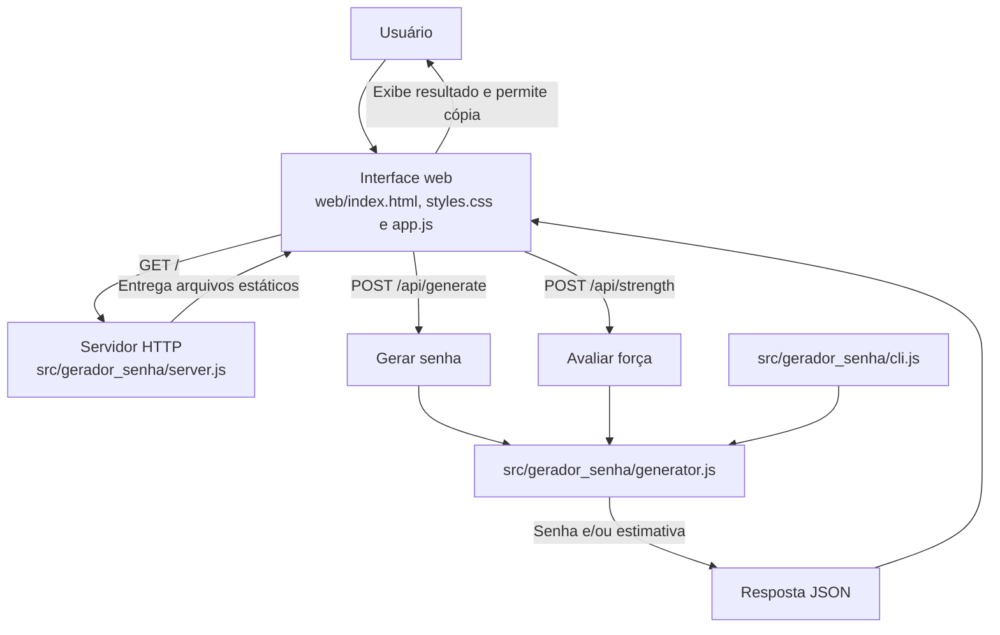

# Gerador de Senhas

Aplicação web e CLI para gerar senhas configuráveis. A geração usa o módulo
criptográfico `node:crypto`; as senhas não são gravadas pela aplicação.

## Requisitos

- Node.js 20.6 ou superior.
- npm, incluído na instalação do Node.js.
- Git, caso o projeto ainda precise ser clonado.

O projeto não possui dependências npm externas; não é necessário executar
`npm install`.

### Atalhos com Make

O arquivo `Makefile` oferece os alvos `install`, `run` e `test`. É necessário
ter GNU Make, Node.js e npm instalados e disponíveis no `PATH`. No Windows,
use um ambiente que forneça GNU Make, como Git Bash ou MSYS2.

```sh
make install
make run
make test
```

O alvo `install` prepara as dependências npm sem criar um `package-lock.json`.
Atualmente, o projeto não declara dependências externas.

## Instalação

No PowerShell, clone o repositório e entre na pasta do projeto:

```powershell
git clone https://github.com/alenocb/gerador-senha-web.git
Set-Location gerador-senha-web
```

Se o repositório já estiver disponível localmente, basta abrir sua pasta no
terminal. Confira a versão instalada do Node.js:

```powershell
node --version
```

Crie o arquivo local `.env` a partir do modelo versionado:

```powershell
Copy-Item .env.example .env
```

O `.env` contém apenas configurações locais e é ignorado pelo Git. O
`.env.example` contém valores seguros para desenvolvimento e pode ser
compartilhado.

## Execução da interface web

Inicie o servidor na raiz do projeto:

```powershell
npm.cmd start
```

Abra <http://127.0.0.1:3000>. O servidor usa `127.0.0.1` e a porta `3000` por
padrão. Para configurar outro endereço ou porta no PowerShell:

```powershell
$env:HOST = "127.0.0.1"
$env:PORT = "3001"
npm.cmd start
```

As variáveis de ambiente definidas no processo têm precedência sobre os
valores carregados de `.env`.

Use o formulário para selecionar o comprimento e os grupos de caracteres,
gerar uma senha e copiá-la para a área de transferência. A interface inicia
automaticamente uma geração ao ser carregada.

## Uso da CLI

Mostre a ajuda:

```powershell
npm.cmd run cli -- --help
```

Exemplos:

```powershell
npm.cmd run cli -- --length 24 --special-characters
npm.cmd run cli -- --length 32 --no-uppercase --no-digits
npm.cmd run cli -- --length=20 --no-special-characters
```

Opções:

| Opção | Descrição |
| --- | --- |
| `-l`, `--length NUMERO` | Comprimento da senha; padrão `16`, máximo `256`. |
| `--lowercase`, `--no-lowercase` | Incluir ou excluir letras minúsculas; por padrão, incluir. |
| `--uppercase`, `--no-uppercase` | Incluir ou excluir letras maiúsculas; por padrão, incluir. |
| `--digits`, `--no-digits` | Incluir ou excluir números; por padrão, incluir. |
| `--special-characters`, `--no-special-characters` | Incluir ou excluir caracteres especiais; por padrão, excluir. |
| `-h`, `--help` | Exibir a ajuda. |

Cada grupo habilitado aparece pelo menos uma vez. O comprimento precisa ser
igual ou maior que a quantidade de grupos habilitados. Opções inválidas são
informadas no `stderr`, e a CLI termina com código de saída `2`.

## API HTTP

A interface web é servida pelo mesmo processo que fornece estes endpoints:

| Método e rota | Descrição | Resposta de sucesso |
| --- | --- | --- |
| `GET /` | Serve a interface web. | HTML da aplicação. |
| `POST /api/generate` | Gera uma senha e avalia sua força. | JSON com `password` e `strength`. |
| `POST /api/strength` | Avalia as opções sem gerar senha. | JSON com `strength`. |

Os arquivos estáticos também estão disponíveis por `GET` e `HEAD` em
`/index.html`, `/styles.css` e `/app.js`.

As rotas POST esperam `Content-Type: application/json` e um objeto com
`length` (inteiro de `1` a `256`) e as opções booleanas `lowercase`,
`uppercase`, `digits` e `specialCharacters`. Quando omitidas, as opções seguem
os padrões da CLI: comprimento `16`, letras minúsculas e maiúsculas e números
habilitados, caracteres especiais desabilitados. A requisição JSON tem limite
de 4096 bytes.

A estimativa usa `comprimento × log2(tamanho do alfabeto selecionado)`:
menos de 40 bits é classificada como fraca, de 40 a 69 como média e 70 ou mais
como forte.

Exemplo de requisição para gerar:

```json
{
  "length": 20,
  "lowercase": true,
  "uppercase": true,
  "digits": true,
  "specialCharacters": false
}
```

Erros de validação e requisições malformadas retornam JSON com a propriedade
`error`. O servidor também usa códigos HTTP apropriados para tipo de conteúdo
não suportado (`415`), corpo excessivo (`413`), rota inexistente (`404`),
método não permitido (`405`) e falha ao carregar um arquivo da interface
(`500`).

## Arquitetura

```text
src/gerador_senha/
  cli.js          Lê argumentos da linha de comando e imprime a senha.
  generator.js    Valida opções, gera senhas e estima a força.
  server.js       Serve arquivos web e implementa os endpoints HTTP.
web/
  index.html      Estrutura da interface.
  styles.css      Estilos e apresentação.
  app.js          Interações, chamadas à API e cópia para a área de transferência.
tests/
  generator.test.js
  server.test.js
```

O módulo `generator.js` centraliza as regras compartilhadas pela CLI e pela
API. A geração usa `randomInt` de `node:crypto`; cada grupo selecionado é
incluído antes de completar o restante da senha e embaralhá-la.



## Testes

Execute a suíte automatizada:

```powershell
npm.cmd test
```

Os testes usam o runner nativo `node:test` e cobrem regras de geração,
validações, estimativa de força, CLI, entrega da interface e endpoints HTTP.
Não é necessário instalar dependências de teste.

## Segurança e limitações

- A aplicação não armazena senhas em arquivo ou banco de dados. A senha gerada
  é enviada do servidor local ao navegador pela API.
- A estimativa de força é teórica: considera comprimento e tamanho dos grupos,
  mas não verifica senhas comprometidas nem garante resistência contra
  qualquer ataque.
- A interface limita o comprimento a 4–64 caracteres; a API e a CLI aceitam
  de 1 a 256, desde que o comprimento comporte todos os grupos selecionados.
- Copiar para a área de transferência depende das permissões e do suporte do
  navegador. Em geral, esse recurso exige um contexto seguro, como `localhost`
  ou HTTPS.
- O servidor é destinado a uso local e se vincula a `127.0.0.1` por padrão.
  Expor o serviço em uma rede requer configuração e medidas adicionais, como
  HTTPS e controles de acesso.

## Próximos passos

- Adicionar testes para respostas de erro HTTP, limite do corpo e método
  `HEAD`.
- Avaliar uma política opcional para excluir caracteres ambíguos.
- Melhorar a estimativa de força, deixando explícitas suas hipóteses e limites.
- Se houver necessidade de acesso em rede, definir e testar uma configuração
  de implantação com HTTPS, controles de acesso e limitação de requisições.
